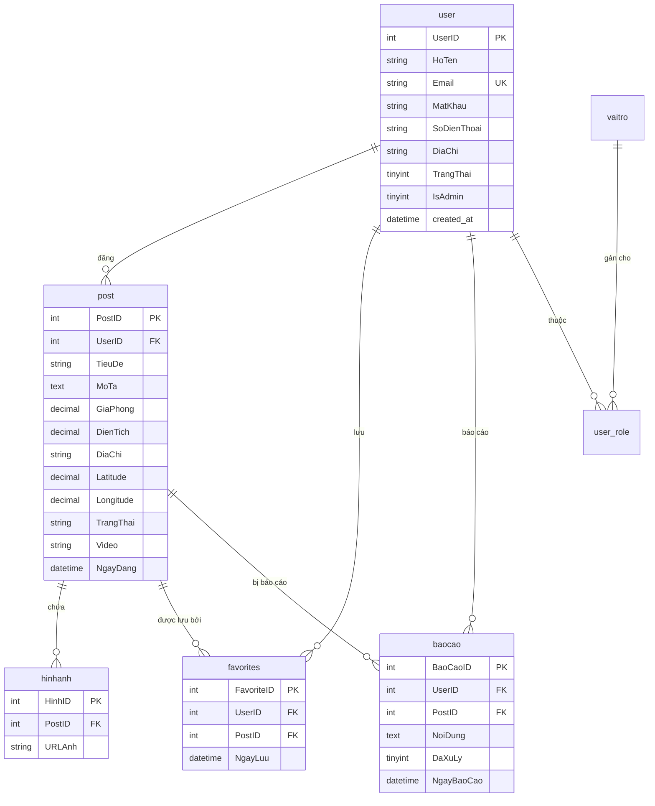

# PhongTroQN - Nền Tảng Tìm Kiếm & Cho Thuê Phòng Trọ Quy Nhơn

[](https://www.php.net/)
[](https://www.mysql.com/)
[](tests/)
[](docker-compose.yml)
[](docs/ARCHITECTURE.md)

PhongTroQN là website kết nối người có nhu cầu thuê phòng và các chủ nhà trọ tại thành phố Quy Nhơn (Bình Định). Dự án được xây dựng theo kiến trúc **PHP thuần tự xây MVC**, router regex/match riêng biệt, giao tiếp MySQL qua PDO Singleton, bản đồ vị trí trực quan bằng **Leaflet & OpenStreetMap**.

Mã nguồn đã được tái cấu trúc và củng cố toàn diện, tối ưu bảo mật, hiệu năng và sẵn sàng triển khai môi trường Docker/CI-CD phục vụ đánh giá năng lực tuyển dụng Backend / Fullstack Engineer.

---

## 🌟 Điểm Nhấn Kỹ Thuật (CV Highlights)

- **Bảo Mật Toàn Diện (Security Hardened)**:
  - **Upload file an toàn tuyệt đối**: Kiểm tra phần mở rộng file (whitelist) kết hợp xác thực định dạng MIME thực tế bằng `finfo_file()`. Đổi tên file ngẫu nhiên qua `bin2hex(random_bytes(16))`. Khóa quyền thực thi script PHP trong thư mục upload bằng `.htaccess` (`engine off`).
  - **Phòng chống CSRF**: Middleware CSRF bảo vệ toàn bộ HTTP mutating requests (`POST`, `PUT`, `DELETE`) với token `random_bytes(32)`.
  - **Chống IDOR (Insecure Direct Object References)**: Kiểm tra nghiêm ngặt quyền sở hữu khi sửa hoặc xóa bài đăng. Chuyển thao tác xóa bài sang phương thức HTTP `POST`.
  - **Quản lý phiên & Auth Middleware**: Khởi tạo session an toàn (`HttpOnly`, `SameSite=Lax`, `Secure`), gọi `session_regenerate_id(true)` ngay khi đăng nhập để ngăn chặn Session Fixation.
  - **Bảo vệ Secret**: Tách toàn bộ cấu hình nhạy cảm (DB, SMTP, App keys) ra file `.env`, không bao giờ commit secret vào Git.
  - **Bảo mật OTP & Chống Brute-force**: Sinh OTP bằng `random_int()`, lưu hash bảo mật bằng `password_hash()`, giới hạn tần suất gửi OTP (60s) và giới hạn 5 lần nhập sai. Thêm Rate Limiting khi đăng nhập sai quá 5 lần.

- **Hiệu Năng Cao (High Performance)**:
  - **Lọc tin 100% bằng SQL**: Thay thế hoàn toàn vòng lặp lọc PHP trên RAM bằng truy vấn SQL tối ưu (`WHERE` linh hoạt, Prepared Statements).
  - **Phân trang dữ liệu**: Triển khai `LIMIT` và `OFFSET` chuẩn mực kết hợp lưu giữ các bộ lọc tìm kiếm trên URL.
  - **Tối ưu Index**: Đánh chỉ mục tổ hợp (`TrangThai`, `GiaPhong`, `DienTich`, `PostID`) và khóa ngoại `ON DELETE CASCADE`.

- **Cấu Trúc Sạch Sẽ (Clean Architecture & DevOps)**:
  - Tích hợp chuẩn **Composer & PSR-4 Autoload**, xóa bỏ các thư viện nhúng thủ công.
  - **Lớp Validator tập trung** hỗ trợ nhiều quy tắc (`required`, `numeric`, `min`, `max`, `phone`, `video_url` YouTube/TikTok whitelist...).
  - **Ghi log tập trung (Centralized Logging)** và trang lỗi 500 thân thiện, ẩn chi tiết hệ thống khi chạy production.
  - Bộ kiểm thử tự động **PHPUnit** với 21 unit tests (100% pass) hỗ trợ SQLite in-memory database độc lập.
  - Đóng gói trọn gói bằng **Docker & Docker Compose** (PHP 8.2 + Apache + MySQL 8.0 + phpMyAdmin).
  - Tích hợp **GitHub Actions CI** tự động kiểm tra cú pháp PHP (`php -l`) và chạy test suite trên mỗi commit.

---

## 🗄️ Mô Hình Cơ Sở Dữ Liệu (ERD)

Chi tiết sơ đồ luồng dữ liệu và thiết kế kiến trúc xem tại: [`docs/ARCHITECTURE.md`](docs/ARCHITECTURE.md).



---

## 🚀 Hướng Dẫn Cài Đặt & Chạy Dự Án

### Cách 1: Chạy Siêu Tốc Bằng Docker (Khuyến Nghị)

Yêu cầu máy đã cài **Docker** và **Docker Compose**.

```bash
# 1. Clone repository
git clone https://github.com/your-username/PhongTroQN.git
cd PhongTroQN

# 2. Khởi chạy toàn bộ hệ thống bằng 1 lệnh duy nhất
docker compose up -d
```

Hệ thống sẽ tự động:
- Build môi trường PHP 8.2 Apache và cài đặt Composer dependencies.
- Khởi động MySQL 8.0 và tự động import [`database/schema.sql`](database/schema.sql) và [`database/seed.sql`](database/seed.sql).
- Kích hoạt giao diện quản trị phpMyAdmin.

**Địa chỉ truy cập**:
- Ứng dụng web: [http://localhost:8080](http://localhost:8080)
- phpMyAdmin: [http://localhost:8081](http://localhost:8081) (User: `root`, Password: `root_secret_password`)

---

### Cách 2: Chạy Trên Môi Trường Local (XAMPP / WAMP)

1. **Chuẩn bị mã nguồn**:
   - Sao chép thư mục dự án vào `htdocs`: `C:\xampp\htdocs\PhongTroQN`
2. **Cấu hình môi trường**:
   - Sao chép file `.env.example` thành `.env`:
     ```bash
     copy .env.example .env
     ```
   - Chỉnh sửa thông tin CSDL trong file `.env` nếu cần:
     ```env
     DB_HOST=127.0.0.1
     DB_PORT=3306
     DB_NAME=phongtroqn
     DB_USER=root
     DB_PASS=
     ```
3. **Cài đặt thư viện**:
   ```bash
   composer install
   ```
4. **Import Cơ sở dữ liệu**:
   - Tạo Database mới tên `phongtroqn` trong phpMyAdmin với collation `utf8mb4_unicode_ci`.
   - Import lần lượt 2 file:
     1. [`database/schema.sql`](database/schema.sql) (Cấu trúc bảng, khóa ngoại, indexes)
     2. [`database/seed.sql`](database/seed.sql) (Dữ liệu mẫu tài khoản và bài đăng)
5. **Khởi chạy**:
   - Truy cập trình duyệt: [http://localhost/PhongTroQN/public](http://localhost/PhongTroQN/public) (hoặc virtual host tương ứng).

---

## 👥 Danh Sách Tài Khoản Demo

Dữ liệu mẫu đã được cung cấp sẵn trong `database/seed.sql`:

| Vai Trò | Email Đăng Nhập | Mật Khẩu | Quyền Hạn |
| :--- | :--- | :--- | :--- |
| **Quản trị viên (Admin)** | `admin@phongtroqn.com` | `admin123` | Quản trị tin đăng, duyệt báo cáo vi phạm, quản lý người dùng |
| **Chủ nhà trọ** | `chutro@gmail.com` | `123456` | Đăng tin, cập nhật, xóa bài đăng của mình, xem tin đã lưu |
| **Người thuê trọ** | `user@gmail.com` | `123456` | Xem tin trọ, lưu tin yêu thích, gửi báo cáo phòng trọ ảo |

---

## 🧪 Kiểm Thử Tự Động (Unit Testing)

Dự án tích hợp bộ kiểm thử đơn vị với PHPUnit 9.6:

```bash
# Chạy toàn bộ test suite
vendor/bin/phpunit

# Kết quả kiểm thử mẫu:
# OK (21 tests, 74 assertions)
```

**Các nhóm bài kiểm tra**:
- `HelperFunctionsTest`: Kiểm tra hàm chuyển đổi chuỗi tiếng Việt Unicode không dấu (`vn_str_filter`), định dạng tiền tệ (`money`), lọc XSS (`e`), cơ chế thông báo Session Flash.
- `ValidatorTest`: Kiểm tra các quy tắc xác thực dữ liệu (chuỗi, số, khoảng giá, diện tích, tọa độ vĩ độ/kinh độ, whitelist link video YouTube & TikTok).
- `CsrfTest`: Kiểm tra tính ngẫu nhiên của token, mã HTML input ẩn và xác thực token hợp lệ/bất hợp pháp.
- `AuthTest`: Kiểm tra logic phân quyền, bảo vệ trạng thái khách/thành viên/admin, dọn dẹp an toàn session khi đăng xuất.
- `DatabaseModelTest`: Kiểm tra các thao tác truy vấn CSDL của `User` và `Post` model (tạo bài, lấy chi tiết, xóa cascade) trên cơ sở dữ liệu SQLite in-memory độc lập.

---

## ⚙️ Biến Môi Trường (.env)

| Tên Biến | Ý Nghĩa | Mặc Định Mẫu |
| :--- | :--- | :--- |
| `APP_ENV` | Môi trường ứng dụng (`local` / `production`) | `local` |
| `APP_DEBUG` | Bật/tắt chế độ debug hiển thị chi tiết lỗi | `true` |
| `BASE_URL` | Đường dẫn gốc của website | `http://localhost:8080` |
| `DB_HOST` | Địa chỉ máy chủ MySQL | `127.0.0.1` (hoặc `db` trên Docker) |
| `DB_PORT` | Cổng kết nối CSDL | `3306` |
| `DB_NAME` | Tên cơ sở dữ liệu | `phongtroqn` |
| `DB_USER` | Tên người dùng CSDL | `root` |
| `DB_PASS` | Mật khẩu người dùng CSDL | `` |
| `SMTP_HOST` | Địa chỉ máy chủ gửi mail SMTP | `smtp.gmail.com` |
| `SMTP_USER` | Tài khoản gửi mail | `example@gmail.com` |
| `SMTP_PASS` | Mật khẩu ứng dụng (App Password) | `your_smtp_app_password` |
| `SMTP_PORT` | Cổng gửi mail SMTP (TLS/SSL) | `587` |

---

## 📁 Cấu Trúc Thư Mục Dự Án

```
PhongTroQN/
├── .github/workflows/       # CI/CD pipeline (GitHub Actions)
├── app/
│   ├── Controllers/         # Các Controller xử lý nghiệp vụ (Auth, Post, User, Admin...)
│   ├── Helpers/             # Thư viện dùng chung (Auth, Csrf, Validator, Logger, Env...)
│   ├── Models/              # Models kết nối CSDL PDO (DB, User, Post, Favorite...)
│   ├── Views/               # Giao diện hiển thị (home, post, user, admin, partials, errors)
│   └── functions.php        # Router regex/match và các helper functions cốt lõi
├── config/
│   └── config.php           # Cấu hình nạp hằng số môi trường
├── database/
│   ├── schema.sql           # Cấu trúc CSDL InnoDB utf8mb4 kèm khóa ngoại & index
│   └── seed.sql             # Dữ liệu khởi tạo (Admin, người dùng, tin đăng mẫu tại Quy Nhơn)
├── docs/
│   └── ARCHITECTURE.md      # Tài liệu kiến trúc, sơ đồ luồng route và ERD chi tiết
├── public/                  # Web root công khai
│   ├── assets/              # Tài nguyên tĩnh (CSS, JS, Hình ảnh giao diện)
│   ├── uploads/             # Thư mục lưu file upload (có .htaccess bảo vệ)
│   └── index.php            # Điểm đón đầu request (Front Controller)
├── storage/
│   └── logs/                # File log hệ thống (app.log)
├── tests/                   # Bộ kiểm thử đơn vị PHPUnit
│   ├── Unit/                # Các test cases (Auth, Csrf, Validator, Helpers, Model)
│   └── bootstrap.php        # Cấu hình nạp test runner
├── .dockerignore
├── .env.example             # Mẫu biến môi trường an toàn
├── .gitignore
├── CHANGELOG.md             # Nhật ký nâng cấp chi tiết
├── Dockerfile               # Cấu hình container PHP 8.2 Apache
├── docker-compose.yml       # Điều phối app, mysql và phpmyadmin
├── phpunit.xml              # Cấu hình chạy kiểm thử PHPUnit
└── README.md                # Tài liệu hướng dẫn dự án
```

---

## 📜 Giấy Phép & Bản Quyền

Dự án được xây dựng và phát triển phục vụ mục đích học tập, nghiên cứu và đưa vào hồ sơ ứng tuyển vị trí Backend / Fullstack Developer. Mọi đóng góp và mã nguồn được chia sẻ theo giấy phép MIT.
