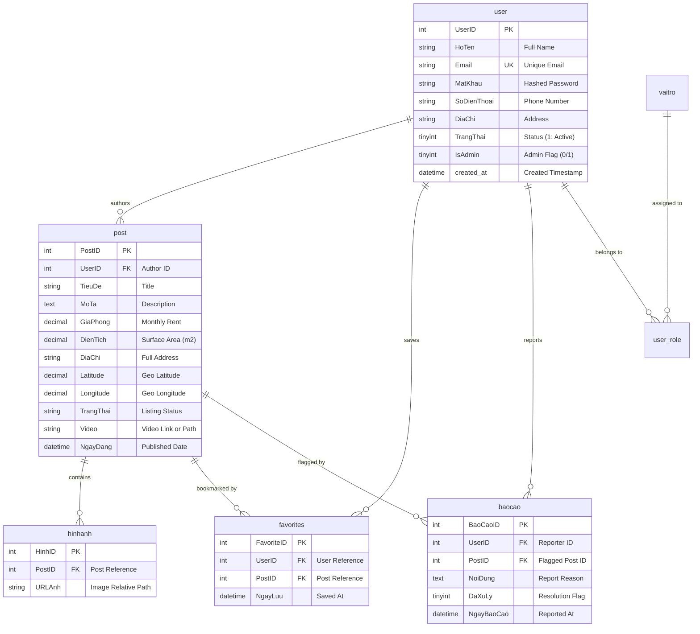

# PhongTroQN - Accommodation Rental & Room Finding Platform

[](https://www.php.net/)
[](https://www.mysql.com/)
[](tests/)
[](docker-compose.yml)
[](docs/ARCHITECTURE.md)
[](LICENSE)

**PhongTroQN** is a full-featured web platform connecting room seekers with rental property landlords in Quy Nhon City, Vietnam. Built from the ground up using **Vanilla PHP with a custom MVC architecture**, an expressive regex/match router, a PDO Singleton database abstraction, and interactive spatial mapping powered by **Leaflet & OpenStreetMap**.

The codebase has undergone comprehensive security hardening, query performance optimization, and architectural refactoring. It is fully containerized with Docker and integrated with GitHub Actions CI, engineered to demonstrate production-grade Backend / Fullstack engineering standards.

---

## 🌟 Technical Highlights 

### 🛡️ Bulletproof Security (Hardened)
- **Zero-Trust File Upload Pipeline**:
  - Whitelists file extensions and verifies genuine MIME types via `finfo_file()` (preventing MIME spoofing and polyglot payloads).
  - Generates cryptographically secure, unpredictable filenames using `bin2hex(random_bytes(16))`.
  - Disables PHP script execution in the upload directory via custom `.htaccess` directives (`engine off`, handler stripping, access denial for executables).
  - Implements strict file size quotas (5MB for images, 30MB for videos).
- **Comprehensive CSRF Defense**:
  - Centralized `Csrf` helper generating 256-bit cryptographically secure tokens.
  - Global middleware intercepting and validating all mutating HTTP requests (`POST`, `PUT`, `DELETE`).
  - Seamless integration with both form helpers (`csrf_field()`) and AJAX requests via `X-CSRF-Token` headers.
- **Strict IDOR (Insecure Direct Object Reference) Prevention**:
  - Verifies record ownership on every edit and delete operation: only the original post author (`UserID`) or verified Administrators are authorized.
  - Converted destructive post deletion from HTTP `GET` to HTTP `POST` protected by CSRF tokens.
- **Unified Session & Auth Middleware**:
  - Centralized authentication helper (`Auth`) ensuring safe session initialization with `HttpOnly`, `SameSite=Lax`, and conditional `Secure` cookie flags.
  - Invokes `session_regenerate_id(true)` upon successful login to thwart **Session Fixation** attacks.
  - Standardized user state across the application, eliminating conflicting session keys.
- **Zero Secret Commits (.env)**:
  - Extracted all database credentials, SMTP keys, and application configurations into environment variables (`.env`).
  - Provided a production-ready `.env.example` template; strictly enforced Git exclusion for secrets.
- **Secure OTP & Brute-Force Rate Limiting**:
  - Generates verification codes using `random_int(100000, 999999)` (CSPRNG).
  - Stores only salted `password_hash()` hashes in sessions; validates through `password_verify()`.
  - Enforces a 60-second cooldown between OTP requests and locks attempts after 5 failures.
  - Implements login throttle mechanisms against credential stuffing.

---

### ⚡ High Performance & Database Optimization
- **100% SQL-Driven Filtering**:
  - Eliminated legacy in-memory PHP array filtering loops.
  - Implemented dynamic prepared SQL queries with selective `WHERE` clauses for prices, room types, surface areas, and geographic locations.
- **Database Pagination**:
  - Replaced bulk record fetching with SQL `LIMIT` and `OFFSET` (12 posts per page).
  - Built an intuitive pagination UI component maintaining active search filter query parameters across page transitions.
- **Composite Indexing & Integrity**:
  - Designed optimal composite indexes: `idx_post_filter (TrangThai, GiaPhong, DienTich, PostID)`, `idx_post_user (UserID)`, and `idx_baocao_status (DaXuLy)`.
  - Configured Foreign Keys with `ON DELETE CASCADE` across all relational entities (`hinhanh`, `favorites`, `baocao`).

---

### 🏗️ Clean Architecture & DevOps
- **Composer & PSR-4 Autoloading**:
  - Clean `composer.json` managing dependencies (`vlucas/phpdotenv`, `phpmailer/phpmailer`, `phpunit/phpunit`).
  - Configured PSR-4 autoloading for `App\` namespace and classmaps for Controllers, Models, and Helpers.
  - Purged 69 committed legacy vendor files.
- **Centralized Validator & Flash Messaging**:
  - Reusable `Validator` supporting rules: `required`, `numeric`, `min`, `max`, `min_len`, `max_len`, `phone`, `email`, `latitude`, `longitude`, and video domain whitelisting (`YouTube`, `TikTok`).
  - Modernized user feedback with session-driven flash notifications, replacing legacy JavaScript `alert()` popups.
- **Centralized Logging & Environment-Aware Error Handling**:
  - Custom `Logger` recording timestamped events (`[DATE] [LEVEL]: Message`) to `storage/logs/app.log`.
  - Global uncaught exception handler rendering a user-friendly 500 error page in production while exposing verbose stack traces when `APP_DEBUG=true`.
- **Automated Testing Suite (PHPUnit)**:
  - 21 unit tests (74 assertions) achieving **100% pass rate**.
  - Decoupled database testing using standalone **SQLite in-memory** fixtures.
- **Full Dockerization & CI/CD**:
  - Custom multi-stage `Dockerfile` (PHP 8.2 Apache + `mod_rewrite` + required extensions).
  - `docker-compose.yml` orchestrating application, MySQL 8.0 (with automated schema & seed ingestion), and phpMyAdmin.
  - **GitHub Actions CI Pipeline** running linting (`php -l`) and PHPUnit tests across PHP 8.0, 8.1, and 8.2.

---

## 🗄️ Database Entity-Relationship Diagram (ERD)

Detailed system architecture diagrams, route maps, and data workflows are documented in [`docs/ARCHITECTURE.md`](docs/ARCHITECTURE.md).



---

## 🚀 Quick Start & Installation

### Option 1: Instant Setup via Docker (Recommended)

**Prerequisites**: [Docker Desktop](https://www.docker.com/) and [Docker Compose](https://docs.docker.com/compose/) installed.

```bash
# 1. Clone the repository
git clone https://github.com/your-username/PhongTroQN.git
cd PhongTroQN

# 2. Spin up the entire environment with one command
docker compose up -d
```

Docker will automatically:
- Build the PHP 8.2 Apache image and install Composer dependencies.
- Boot MySQL 8.0 and automatically execute [`database/schema.sql`](database/schema.sql) followed by [`database/seed.sql`](database/seed.sql).
- Start phpMyAdmin for database inspection.

**Access Endpoints**:
- **Web Application**: [http://localhost:8080](http://localhost:8080)
- **phpMyAdmin**: [http://localhost:8081](http://localhost:8081)
  - Username: `root`
  - Password: `root_secret_password`

---

### Option 2: Local Development Setup (XAMPP / WAMP / Native)

**Prerequisites**: PHP >= 8.0, MySQL >= 8.0 (or MariaDB >= 10.4), [Composer](https://getcomposer.org/).

1. **Deploy Source**:
   - Clone or move the directory to your web root (e.g., `C:\xampp\htdocs\PhongTroQN`).
2. **Environment Configuration**:
   - Copy the sample environment file:
     ```bash
     cp .env.example .env     # Linux/macOS
     copy .env.example .env   # Windows
     ```
   - Update database credentials inside `.env` to match your local setup:
     ```env
     DB_HOST=127.0.0.1
     DB_PORT=3306
     DB_NAME=phongtroqn
     DB_USER=root
     DB_PASS=
     ```
3. **Install Dependencies**:
   ```bash
   composer install
   ```
4. **Database Migration**:
   - Create an empty database named `phongtroqn` with collation `utf8mb4_unicode_ci`.
   - Import the schema and seed files in order:
     1. [`database/schema.sql`](database/schema.sql) (Tables, Constraints, Foreign Keys, Indexes)
     2. [`database/seed.sql`](database/seed.sql) (Demo Accounts, Verified Listings with Coordinates)
5. **Launch**:
   - Start Apache & MySQL services.
   - Navigate to: [http://localhost/PhongTroQN/public](http://localhost/PhongTroQN/public).

---

## 👥 Demo Credentials

Pre-seeded accounts are provided in [`database/seed.sql`](database/seed.sql) for testing:

| Role | Email | Password | Permissions |
| :--- | :--- | :--- | :--- |
| **System Administrator** | `admin@phongtroqn.com` | `admin123` | Full admin privileges: moderate listings, review violation reports, manage users. |
| **Landlord (Chủ Trọ)** | `chutro@gmail.com` | `123456` | Create listings, update/delete own listings, upload media, view saved rooms. |
| **Tenant (Người Thuê)** | `user@gmail.com` | `123456` | Browse listings, filter & paginate, bookmark favorites, report invalid listings. |

---

## 🧪 Automated Testing (Unit Testing)

The project includes an isolated test suite powered by PHPUnit 9.6:

```bash
# Execute the full test suite
vendor/bin/phpunit

# Sample test output:
# PHPUnit 9.6.38 by Sebastian Bergmann and contributors.
# .....................                                             21 / 21 (100%)
# Time: 00:00.055, Memory: 6.00 MB
# OK (21 tests, 74 assertions)
```

**Test Coverage Highlights**:
- `HelperFunctionsTest`: Validates Vietnamese Unicode accent stripping (`vn_str_filter`), currency formatting (`money`), XSS escaping (`e`), and single-use session flash messaging.
- `ValidatorTest`: Verifies validation rules (mandatory fields, numeric boundaries, Vietnamese mobile numbers, geolocation ranges, and YouTube/TikTok URL whitelist).
- `CsrfTest`: Asserts token randomness, hidden input generation, and constant-time string token comparison.
- `AuthTest`: Tests authentication states, guest restrictions, role elevation (`isAdmin`), and session teardown on logout.
- `DatabaseModelTest`: Exercises CRUD operations and cascade deletions across `User` and `Post` models using an isolated in-memory SQLite database.

---

## ⚙️ Environment Variables (.env)

| Variable | Description | Default / Example |
| :--- | :--- | :--- |
| `APP_ENV` | Application environment (`local` / `production`) | `local` |
| `APP_DEBUG` | Display verbose debug stack traces (`true` / `false`) | `true` |
| `BASE_URL` | Root URL of the application | `http://localhost:8080` |
| `DB_HOST` | MySQL hostname or container service name | `127.0.0.1` (or `db` in Docker) |
| `DB_PORT` | MySQL connection port | `3306` |
| `DB_NAME` | Database schema name | `phongtroqn` |
| `DB_USER` | Database user | `root` (or `phongtro_user`) |
| `DB_PASS` | Database password | `secret123` |
| `SMTP_HOST` | Outgoing SMTP mail server | `smtp.gmail.com` |
| `SMTP_USER` | SMTP username | `example@gmail.com` |
| `SMTP_PASS` | SMTP application password | `your_app_password` |
| `SMTP_PORT` | SMTP port (TLS/SSL) | `587` |

---

## 📁 Project Directory Structure

```
PhongTroQN/
├── .github/workflows/       # GitHub Actions CI/CD pipeline
├── app/
│   ├── Controllers/         # Application Controllers (Auth, Post, User, Admin, etc.)
│   ├── Helpers/             # Core Utilities (Auth, Csrf, Validator, Logger, Env, Mail)
│   ├── Models/              # PDO Database Models (DB Singleton, User, Post, Favorite)
│   ├── Views/               # View Templates (home, post, user, admin, partials, errors)
│   └── functions.php        # Custom Regex/Match Router & Core Helpers
├── config/
│   └── config.php           # Global configuration bootstrapping
├── database/
│   ├── schema.sql           # InnoDB utf8mb4 DDL with constraints & indexes
│   └── seed.sql             # Realistic seed data (accounts, Quy Nhon room listings)
├── docs/
│   └── ARCHITECTURE.md      # In-depth architectural design, routes & ERD documentation
├── public/                  # Public web root
│   ├── assets/              # Static assets (CSS, JavaScript, UI graphics)
│   ├── uploads/             # Media storage (protected by .htaccess)
│   └── index.php            # Front Controller entrypoint
├── storage/
│   └── logs/                # Centralized application logs (app.log)
├── tests/                   # Automated PHPUnit Test Suite
│   ├── Unit/                # Unit test classes (Auth, Csrf, Validator, Models, Helpers)
│   └── bootstrap.php        # Test runner initialization
├── .dockerignore            # Docker build ignore rules
├── .env.example             # Safe environment variable template
├── .gitignore               # Git ignore rules
├── CHANGELOG.md             # Detailed version changelog
├── Dockerfile               # Production-ready PHP 8.2 Apache container definition
├── docker-compose.yml       # Multi-container orchestration (App, MySQL, phpMyAdmin)
├── phpunit.xml              # PHPUnit test configuration
└── README.md                # Project documentation
```

---

## 📜 License

This project is open-sourced software licensed under the [MIT License](LICENSE). Built for educational demonstration, technical portfolio showcases, and engineering career opportunities.
