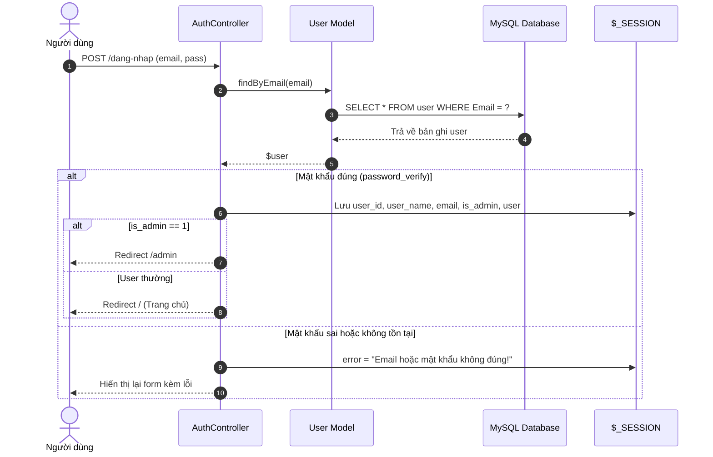
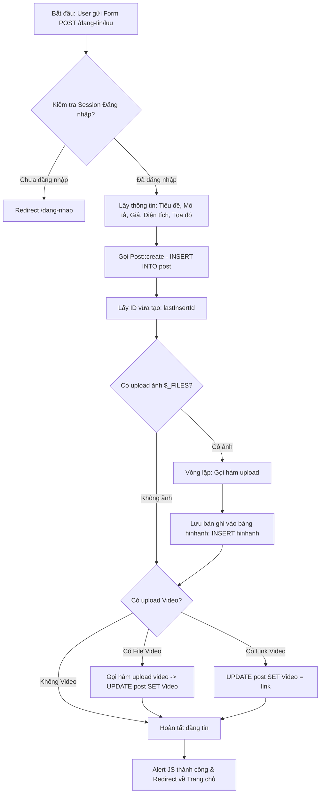
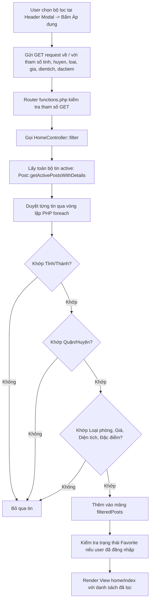
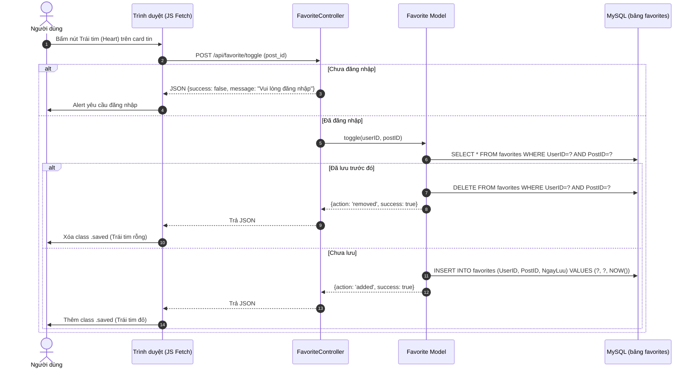
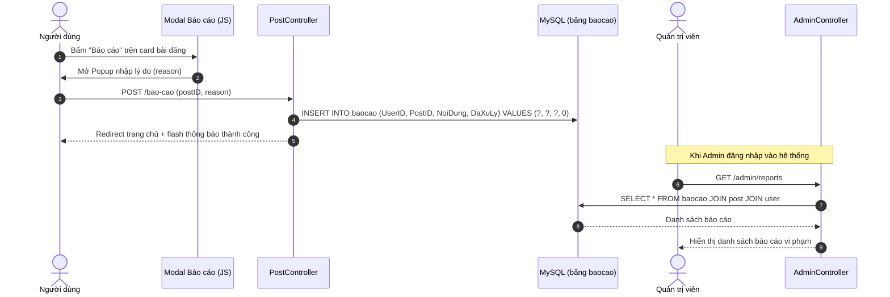
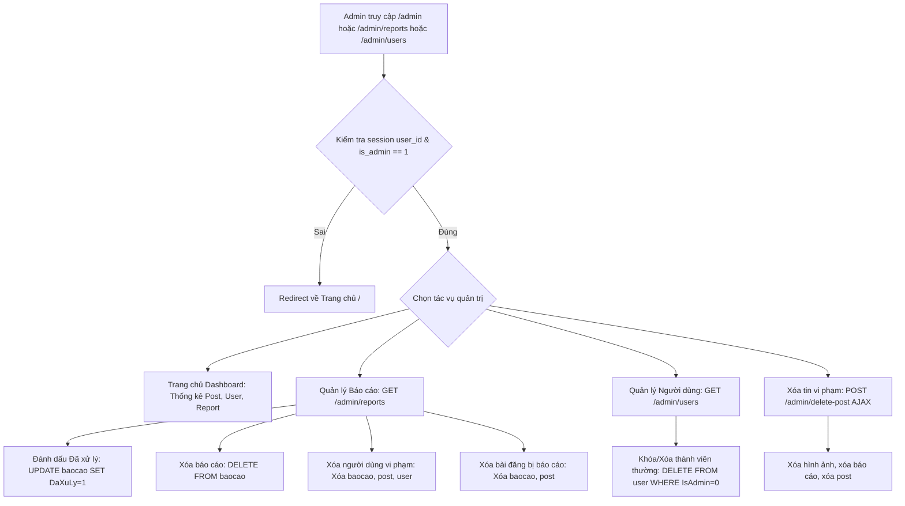
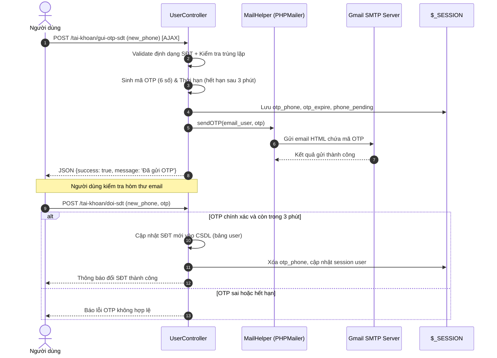
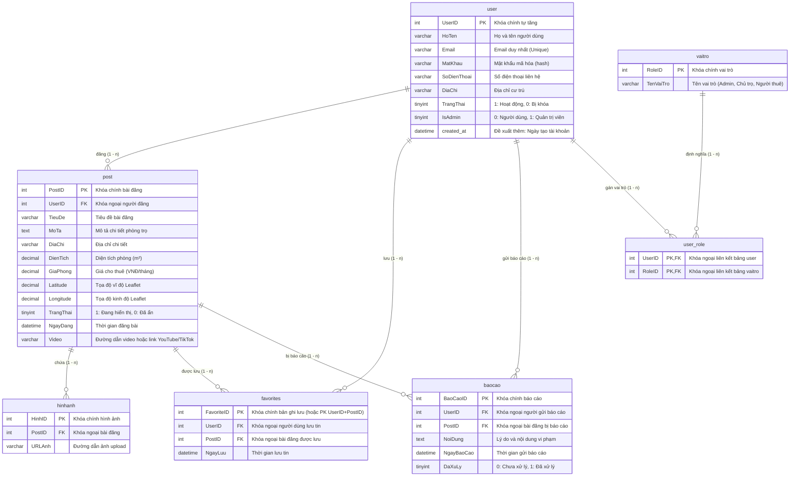

# KIẾN TRÚC HỆ THỐNG DỰ ÁN PHONGTROQN

> **Tài liệu đặc tả kiến trúc kỹ thuật (Technical Architecture Document)**  
> **Dự án**: PhongTroQN - Nền tảng tìm kiếm và đăng tin phòng trọ Quy Nhơn  
> **Công nghệ**: PHP 8.x thuần (Custom MVC + Match Router), MySQL (PDO), PHPMailer, Leaflet/OpenStreetMap, jQuery.

---

## MỤC LỤC
1. [Tổng quan Kiến trúc Hệ thống](#1-tổng-quan-kiến-trúc-hệ-thống)
2. [Sơ đồ Định tuyến & Điểm cuối (Route Map)](#2-sơ-đồ-định-tuyến--điểm-cuối-route-map)
3. [Luồng Nghiệp vụ Chính (Business Flowcharts)](#3-luồng-nghiệp-vụ-chính-business-flowcharts)
   - 3.1. Luồng Xác thực & Phân quyền (Auth & Session)
   - 3.2. Luồng Đăng tin & Tải lên tệp (Post Creation & Uploads)
   - 3.3. Luồng Quản lý tin & Cập nhật/Xóa tin
   - 3.4. Luồng Tìm kiếm & Lọc dữ liệu (Filter Flow)
   - 3.5. Luồng Yêu thích (Favorite Toggle)
   - 3.6. Luồng Báo cáo vi phạm (Report Flow)
   - 3.7. Luồng Quản trị Admin (Dashboard, Reports, Users)
   - 3.8. Luồng Đổi SĐT qua OTP Email
4. [Mô hình Thực thể & Dữ liệu (ERD & Database Schema)](#4-mô-hình-thực-thể--dữ-liệu-erd--database-schema)
   - 4.1. Sơ đồ Quan hệ Thực thể (ERD)
   - 4.2. Đặc tả Chi tiết các Bảng (Suy diễn từ Codebase SQL)
   - 4.3. Các câu hỏi / Điểm chưa rõ về CSDL cần xác nhận
5. [Đánh giá & Audit Codebase Hiện tại](#5-đánh-giá--audit-codebase-hiện-tại)

---

## 1. TỔNG QUAN KIẾN TRÚC HỆ THỐNG

Dự án áp dụng mô hình **MVC tự xây dựng (Custom Lightweight MVC)** kết hợp mô hình **Front Controller**:

```
                       HTTP Request
                            │
                            ▼
                   [public/.htaccess]
                            │ (Rewrite all non-asset URLs)
                            ▼
                    [public/index.php] (Front Controller)
                            │
               ┌────────────┴────────────┐
               ▼                         ▼
      [config/config.php]       [app/functions.php]
     (Env & DB Constants)      (Auto-require, Helpers, Router)
                                         │
                         ┌───────────────┴───────────────┐
                         ▼                               ▼
                 [app/Controllers]                [app/Models]
                  - AuthController                 - DB (PDO singleton)
                  - HomeController                 - User
                  - PostController                 - Post
                  - FavoriteController             - Favorite
                  - UserController                 - hinhanh
                  - AdminController                      │
                         │                               ▼
                         │                        [MySQL Database]
                         ▼
                    [app/Views]
                  - home/, post/, user/
                  - admin/, auth/, errors/
```

- **Front Controller (`public/index.php`)**: Điểm vào duy nhất tiếp nhận HTTP request từ Web Server (Apache qua rewrite rule tại `public/.htaccess`).
- **Core Engine & Router (`app/functions.php`)**:
  - Tự động nạp toàn bộ Controllers và Models bằng hàm `glob()`.
  - Cung cấp các hàm helper toàn cục: `view()`, `redirect()`, `upload()`, `money()`, `e()`, `vn_str_filter()`.
  - Định tuyến kết hợp giữa **Regex Matching** (xử lý route có tham số dạng `/sua-tin/(\d+)`, `/xoa-tin/(\d+)`, `/api/post-detail/(\d+)`) và biểu thức **`match (true)`** của PHP 8.x.
- **Tầng Dữ liệu (`app/Models`)**: Kết nối MySQL thông qua `PDO` đóng gói trong class `DB` (`DB::connect()`) và hàm tiện ích `query($sql, $params)`. (Lưu ý: còn sót kết nối `mysqli` trong `config/config.php` và một số hàm trong `PostController`).

---

## 2. SƠ ĐỒ ĐỊNH TUYẾN & ĐIỂM CUỐI (ROUTE MAP)

Dưới đây là bảng tổng hợp toàn bộ các Route được đăng ký trong hệ thống (`app/functions.php`):

| HTTP Method | URL Pattern / Route | Handler (Controller @ Action) | Yêu cầu xác thực / Quyền hạn | Mô tả chức năng |
|:---|:---|:---|:---|:---|
| **GET** | `/` (kèm tham số `gia`, `loai`, `dientich`, `dactiem`) | `HomeController@filter` | Công khai | Lọc danh sách bài đăng theo tiêu chí |
| **GET** | `/`, `/trang-chu`, `/index.php`, `''` | `HomeController@index` | Công khai | Hiển thị trang chủ, danh sách tin mới nhất |
| **GET / POST** | `/dang-nhap` | `AuthController@login` | Khách (Guest) | Hiển thị form / Xử lý đăng nhập tài khoản |
| **GET / POST** | `/dang-ky` | `AuthController@register` | Khách (Guest) | Hiển thị form / Xử lý đăng ký tài khoản |
| **GET** | `/dang-xuat` | `AuthController@logout` | Đã đăng nhập | Hủy session và chuyển hướng về trang chủ |
| **GET** | `/dang-tin` | `PostController@create` | Yêu cầu đăng nhập (view check) | Hiển thị form soạn bài đăng mới |
| **POST** | `/dang-tin/luu` | `PostController@store` | Yêu cầu đăng nhập (`$_SESSION['user']`) | Lưu thông tin bài đăng, upload ảnh và video |
| **GET** | `/tin-cua-toi` | `PostController@myPosts` | Yêu cầu đăng nhập (`$_SESSION['user']`) | Quản lý danh sách tin do user hiện tại đăng |
| **GET** | `/sua-tin/{id}` | `PostController@edit($id)` | Yêu cầu đăng nhập + Chủ sở hữu | Hiển thị form sửa bài đăng |
| **POST** | `/cap-nhat-tin` | `PostController@update` | Yêu cầu đăng nhập + Chủ sở hữu | Cập nhật thông tin bài đăng vào DB |
| **GET** | `/xoa-tin/{id}` | `PostController@delete($id)` | Yêu cầu đăng nhập + Chủ sở hữu *(Hiện dùng GET)* | Xóa bài đăng và ảnh liên quan |
| **POST** | `/bao-cao` | `PostController@report` | Yêu cầu đăng nhập (`$_SESSION['user_id']`) | Gửi báo cáo bài đăng vi phạm |
| **GET** | `/api/post-detail/{id}` | Anonymous Closure (`app/functions.php`) | Công khai (AJAX) | Trả về JSON chi tiết bài đăng và danh sách ảnh |
| **GET** | `/admin` | `AdminController@index` | Admin (`is_admin == 1`) | Trang Dashboard thống kê số liệu quản trị |
| **GET** | `/admin/reports` | `AdminController@manageReports` | Admin (`is_admin == 1`) | Quản lý, lọc, xử lý hoặc xóa báo cáo/user/post |
| **GET** | `/admin/users` | `AdminController@users` | Admin (`is_admin == 1`) | Quản lý danh sách thành viên thường, xóa user |
| **POST** | `/admin/delete-post` | `AdminController@deletePost` | Admin (`is_admin == 1`, AJAX) | Admin xóa bài đăng qua popup AJAX |
| **GET** | `/admin/post-detail` | `AdminController@getPostDetail` | Admin (`is_admin == 1`, AJAX) | Lấy chi tiết bài đăng phục vụ modal admin |
| **GET** | `/tai-khoan` | `UserController@profile` | Yêu cầu đăng nhập (`$_SESSION['user']`) | Giao diện quản lý thông tin cá nhân |
| **POST** | `/tai-khoan/cap-nhat` | `UserController@updateProfile` | Yêu cầu đăng nhập (`$_SESSION['user']`) | Đổi họ tên người dùng |
| **POST** | `/tai-khoan/doi-sdt` | `UserController@changePhone` | Yêu cầu đăng nhập (`$_SESSION['user']`) | Xác thực OTP và cập nhật số điện thoại mới |
| **POST** | `/tai-khoan/gui-otp-sdt`| `UserController@sendPhoneOTP` | Yêu cầu đăng nhập (AJAX) | Sinh mã OTP và gửi qua Gmail SMTP |
| **POST** | `/tai-khoan/doi-mat-khau`| `UserController@changePassword` | Yêu cầu đăng nhập (`$_SESSION['user']`) | Đổi mật khẩu đăng nhập |
| **GET** | `/tin-da-luu` | `FavoriteController@index` | Yêu cầu đăng nhập (`$_SESSION['user_id']`) | Danh sách các tin người dùng đã yêu thích |
| **POST** | `/api/favorite/toggle` | `FavoriteController@toggle` | Yêu cầu đăng nhập (AJAX) | Thêm vào hoặc xóa khỏi danh sách tin đã lưu |
| **ANY** | `*` (Không khớp route trên) | `view('errors/404')` | Công khai | Hiển thị trang báo lỗi 404 Not Found |

---

## 3. LUỒNG NGHIỆP VỤ CHÍNH (BUSINESS FLOWCHARTS)

### 3.1. Luồng Xác thực & Đăng ký / Đăng nhập


### 3.2. Luồng Đăng tin mới & Tải lên tệp (Post Creation Flow)


### 3.3. Luồng Quản lý, Sửa và Xóa tin đăng của tôi
```mermaid
flowchart TD
    subgraph Sửa tin
    A1[GET /sua-tin/{id}] --> B1{Đã đăng nhập?}
    B1 -- Không --> C1[Redirect /dang-nhap]
    B1 -- Có --> D1[Lấy Post theo ID]
    D1 --> E1{UserID của tin == UserID hiện tại?}
    E1 -- Sai --> F1[Chặn: die 'Không có quyền']
    E1 -- Đúng --> G1[Hiển thị View Edit-Post]
    G1 --> H1[POST /cap-nhat-tin]
    H1 --> I1{Kiểm tra quyền sở hữu}
    I1 -- Hợp lệ --> J1[UPDATE post WHERE PostID=? AND UserID=?]
    J1 --> K1[Redirect /tin-cua-toi?updated=1]
    end

    subgraph Xóa tin
    A2[GET /xoa-tin/{id}] --> B2{Đã đăng nhập?}
    B2 -- Không --> C2[Redirect /dang-nhap]
    B2 -- Có --> D2[Lấy UserID từ session]
    D2 --> E2[DELETE FROM post WHERE PostID=? AND UserID=?]
    E2 --> F2[DELETE FROM hinhanh WHERE PostID=?]
    F2 --> G2[Redirect /tin-cua-toi?deleted=1]
    end
```

### 3.4. Luồng Tìm kiếm & Lọc bài đăng (Filter Flow)


### 3.5. Luồng Yêu thích bài đăng (Favorite Toggle)


### 3.6. Luồng Báo cáo vi phạm (Report Flow)


### 3.7. Luồng Quản trị Admin (Dashboard & Quản lý)


### 3.8. Luồng Đổi số điện thoại qua OTP Email


---

## 4. MÔ HÌNH THỰC THỂ & DỮ LIỆU (ERD & DATABASE SCHEMA)

### 4.1. Sơ đồ Quan hệ Thực thể (ERD)



---

### 4.2. Đặc tả Chi tiết các Bảng (Suy diễn từ Codebase SQL)

Dựa trên toàn bộ câu lệnh SQL thực thi trong `app/Models/User.php`, `Post.php`, `Favorite.php`, `hinhanh.php`, `AdminController.php`, `PostController.php`:

#### 1. Bảng `user`
- `UserID`: `INT AUTO_INCREMENT PRIMARY KEY`
- `HoTen`: `VARCHAR(100) NOT NULL`
- `Email`: `VARCHAR(100) NOT NULL UNIQUE`
- `MatKhau`: `VARCHAR(255) NOT NULL` (Lưu `password_hash()`)
- `SoDienThoai`: `VARCHAR(20) NULL`
- `DiaChi`: `VARCHAR(255) NULL`
- `TrangThai`: `TINYINT DEFAULT 1` (1 = Active, 0 = Banned/Inactive)
- `IsAdmin`: `TINYINT DEFAULT 0` (0 = User thường, 1 = Quản trị viên)
- *(Khuyến nghị thêm)* `created_at`: `DATETIME DEFAULT CURRENT_TIMESTAMP` (Code `AdminController.php` và `users.php` có nhắc đến sự thiếu vắng của cột này).

#### 2. Bảng `vaitro` & Bảng trung gian `user_role`
- Bảng `vaitro`:
  - `RoleID`: `INT AUTO_INCREMENT PRIMARY KEY`
  - `TenVaiTro`: `VARCHAR(50) NOT NULL` (Dữ liệu ngầm định trong code: `3` = "Người thuê")
- Bảng `user_role`:
  - `UserID`: `INT NOT NULL`
  - `RoleID`: `INT NOT NULL`
  - Khóa chính kết hợp: `PRIMARY KEY (UserID, RoleID)`
  - Khóa ngoại: Ràng buộc tới `user(UserID)` và `vaitro(RoleID)`

#### 3. Bảng `post`
- `PostID`: `INT AUTO_INCREMENT PRIMARY KEY`
- `UserID`: `INT NOT NULL` (Khóa ngoại tham chiếu `user.UserID`)
- `TieuDe`: `VARCHAR(255) NOT NULL`
- `MoTa`: `TEXT NULL`
- `DiaChi`: `VARCHAR(255) NOT NULL`
- `DienTich`: `DECIMAL(8,2) NOT NULL DEFAULT 0.00`
- `GiaPhong`: `DECIMAL(15,2) NOT NULL DEFAULT 0.00`
- `Latitude`: `DECIMAL(10,8) NULL`
- `Longitude`: `DECIMAL(11,8) NULL`
- `TrangThai`: `TINYINT DEFAULT 1` (1 = Hiển thị, 0 = Ẩn)
- `NgayDang`: `DATETIME DEFAULT CURRENT_TIMESTAMP`
- `Video`: `VARCHAR(255) NULL` (Đường dẫn video cục bộ hoặc URL ngoài)

#### 4. Bảng `hinhanh`
- `HinhID`: `INT AUTO_INCREMENT PRIMARY KEY`
- `PostID`: `INT NOT NULL` (Khóa ngoại tham chiếu `post.PostID` ON DELETE CASCADE)
- `URLAnh`: `VARCHAR(255) NOT NULL`

#### 5. Bảng `favorites`
- `FavoriteID`: `INT AUTO_INCREMENT PRIMARY KEY` (hoặc khóa kết hợp `UserID`, `PostID`)
- `UserID`: `INT NOT NULL` (Khóa ngoại tham chiếu `user.UserID` ON DELETE CASCADE)
- `PostID`: `INT NOT NULL` (Khóa ngoại tham chiếu `post.PostID` ON DELETE CASCADE)
- `NgayLuu`: `DATETIME DEFAULT CURRENT_TIMESTAMP`
- Ràng buộc: `UNIQUE KEY (UserID, PostID)`

#### 6. Bảng `baocao`
- `BaoCaoID`: `INT AUTO_INCREMENT PRIMARY KEY`
- `UserID`: `INT NOT NULL` (Khóa ngoại tham chiếu `user.UserID` ON DELETE CASCADE)
- `PostID`: `INT NOT NULL` (Khóa ngoại tham chiếu `post.PostID` ON DELETE CASCADE)
- `NoiDung`: `TEXT NOT NULL`
- `NgayBaoCao`: `DATETIME DEFAULT CURRENT_TIMESTAMP`
- `DaXuLy`: `TINYINT DEFAULT 0` (0 = Chưa xử lý, 1 = Đã giải quyết)

---

### 4.3. Các câu hỏi / Điểm chưa rõ về CSDL cần xác nhận với User
1. **Bảng phân quyền (`vaitro` và `user_role`)**: Hiện tại code đăng ký có gán cứng `RoleID = 3` ("Người thuê") vào `user_role`, nhưng kiểm tra quyền Admin trong toàn bộ dự án lại dựa vào cột `user.IsAdmin` (0 hoặc 1) chứ không dùng `user_role`. Chúng ta có nên duy trì cả 2 cơ chế hay tinh gọn thành 1 cơ chế phân quyền nhất quán?
2. **Khóa ngoại và hành vi Cascade**: Khi Admin xóa một bài đăng hoặc xóa một User, hiện tại code PHP đang tự chạy các lệnh `DELETE FROM hinhanh...`, `DELETE FROM baocao...` thủ công. Trong file `schema.sql` sắp tới, chúng ta sẽ thiết lập chuẩn `ON DELETE CASCADE` ở mức CSDL MySQL để đảm bảo toàn vẹn dữ liệu?
3. **Cột `created_at` trong bảng `user`**: Trong `AdminController.php` (dòng 23) và `users.php` (dòng 84) có tham chiếu đến `created_at` của bảng `user` nhưng đang phải gán tạm là 0 hoặc `-`. Chúng ta sẽ chính thức thêm cột `created_at DATETIME DEFAULT CURRENT_TIMESTAMP` vào bảng `user` ở Giai đoạn 2?
4. **Các bảng rác trong file cũ**: Trong `public/dangtin.php` (file mồ côi) có tham chiếu bảng `baidang` thay vì `post`. Ta xác nhận loại bỏ hoàn toàn cấu trúc cũ này.

---

## 5. ĐÁNH GIÁ & AUDIT CODEBASE HIỆN TẠI

Toàn bộ các lỗ hổng bảo mật, lỗi logic, hiệu năng và sự thiếu nhất quán trong codebase đã được lập thành danh sách chi tiết kèm `file:dòng` cụ thể trong báo cáo thẩm định kỹ thuật.

